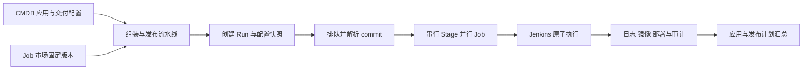

# DevOps 系统完整推荐方案

本方案覆盖现有 10 个专题、76 项需求，面向开发、发布和平台管理的真实操作流程。已有明确选择继续生效，其余内容为用户授权生成的推荐基线，供整体审阅后修改。设计完成不表示产品已经实现，也不表示每条推荐已经单独获得确认。

## 阅读入口

| 文档 | 覆盖需求 | 主要内容 |
|---|---|---|
| [工程规范](01-engineering.md) | ARCH-01 至 ARCH-08 | 简单代码组织、事务、API、前端与跨仓库协作 |
| [CMDB](02-cmdb.md) | CMDB-01 至 CMDB-08 | 空间、应用、环境、交付配置和发布计划 |
| [Job 市场](03-job-catalog.md) | JOB-01 至 JOB-08 | 模板、参数表单、版本、凭据与首批能力 |
| [流水线管理](04-pipeline-management.md) | PIPE-01 至 PIPE-06 | 创建、复制、启停、归档、列表与授权 |
| [流水线组装](05-pipeline-editor.md) | CFG-01 至 CFG-08 | 草稿、Stage/Job 编辑、绑定、校验与发布 |
| [流水线执行](06-execution.md) | RUN-01 至 RUN-09 | 状态机、手动触发、并发、失败、取消与恢复 |
| [Jenkins 接入](07-jenkins.md) | JENKINS-01 至 JENKINS-08 | Controller、Runner、Agent、工作空间与容量 |
| [数据与审计](08-data-and-audit.md) | DATA-01 至 DATA-09 | commit、镜像、快照、节点、日志与保留 |
| [通用运行](09-operations.md) | OPS-01 至 OPS-07 | 登录、密钥、依赖故障、部署、备份与联调 |
| [用户交互](10-user-experience.md) | WEB-01 至 WEB-05 | 导航、页面、编辑器、运行详情与异常交互 |
| [数据模型与接口](11-data-model-and-api.md) | 跨专题契约 | 实体、字段、约束、事务和 API 清单 |
| [实施与验收](12-delivery-and-acceptance.md) | 完整交付 | 分期、实施顺序、场景和覆盖追踪 |
| [重点取舍](13-review-decisions.md) | 集中评审 | 推荐值、理由、影响与替代时应修改的文档 |

## 一次完整交付

1. 平台管理员连接 Jenkins，配置空间 Folder、构建与部署节点池，发布测试、构建镜像、Kubernetes 部署能力。
2. 空间管理员创建子系统和应用，登记源码仓库、镜像仓库、环境、部署目标和凭据引用；连接验证只做权限检查，不触发部署。
3. 开发者在应用下创建流水线。默认示例为“质量检查 → 镜像构建 → 应用部署”，部署 Job 默认手动。
4. 编辑器从市场选择 Job，通过表单填写参数、绑定前序输出。保存草稿后点击“校验并发布”，得到不可变修订。
5. 点击“运行”，选择环境、修订、代码引用和参数，核对目标摘要。后端创建 Run，排队、解析 commit、固定输入，再推进业务 Stage。
6. 用户在运行详情中看到并行 Job、队列原因、实际 commit、镜像和日志。需要手动操作时，页面提供独立 Job 的“执行此任务”。
7. 执行结束后查看源码、镜像 digest、部署目标和操作时间线。关联发布计划时，计划页汇总每个应用的运行结果与实际部署事实。

## 产品边界

| 首期完整提供 | 后续增强，首期界面不出现无效入口 |
|---|---|
| 本地账号、空间权限、应用交付 CMDB | SSO、企业目录同步 |
| 可视化 Stage/Job 编辑、版本发布、人工启动 | Git Webhook、定时触发、通用 DAG、矩阵与条件分支 |
| 同 Stage 并行、单 Job 手动等待 | 多人审批、会签、自动审批策略 |
| 测试、构建推送镜像、更新既有 Kubernetes Deployment | 多集群扇出、首次资源创建、Helm 市场、自动回滚 |
| 全量新 Run、固定镜像的部署专用流水线 | 单节点重试、失败点恢复、脚本自动重试 |
| 发布计划汇总、站内“待我操作” | 跨应用调度、外部通知规则 |

首期范围的收敛旨在让构建、人工放行、部署、失败、取消和故障恢复形成完整闭环；后续增强均有明确的当前处理方式，不用空白按钮或假成功占位。

## 推荐的核心规则

- 每条 Pipeline 属于一个应用，可用于该应用多个环境；每次 Run 只选择一个环境和一个部署目标。
- 定义是一个可编辑草稿加多个不可变修订。只运行已发布修订，历史运行不会跟随最新配置变化。
- 同一应用与环境的所有流水线共享一个活动 Run 槽位；人工等待继续占槽，不占 Jenkins Executor。其他应用或环境可以并行。
- Stage 中所有 Job 成功才能推进。首个失败停止新增工作，已认领的兄弟任务运行至结束；不自动撤回外部副作用。
- 手动触发不能现场修改镜像、参数或目标；在原 Run 上只放行该 Job。要改参数时新建 Run。
- 创建 Run 时固定 CMDB 和配置；取得应用环境槽后解析源码并固定 commit。对排队期间也必须固定代码的场景，提交完整 commit SHA。
- 部署使用同应用、来源可追溯的镜像 digest。发布计划项使用明确 commit，不能把可漂移分支当作确定版本。
- 取消是持久化操作。执行结果不明时显示“状态核对中”，继续持有资源，不伪造已取消或已失败。
- API 与 Worker 独立部署，通过 MySQL 的状态和待办任务恢复执行。首期不引入消息中间件和复杂业务框架。
- 用户日常操作留在本系统；Jenkins 地址、队列编号等放在诊断区，平台管理员可以跳转排障。

## 事实由谁维护

CMDB 拥有身份、空间授权、应用与交付配置、发布计划；Pipeline 拥有模板、流水线、运行、队列、镜像生产记录和部署记录；Jenkins 提供队列、构建和节点观测。Pipeline 的运行快照是当次执行事实，不是第二份可编辑 CMDB。每次远端执行只选定一个可信构建记录，网络故障不改变其归属。

## 规模与默认值

推荐按一个组织内 10 个空间、500 个应用、每日 5,000 次 Run、同时 100 个执行中的 Job 作为首轮容量设计输入；这些是验收负载目标，不是已有性能事实。一个定义最多 20 个 Stage、单 Stage 最多 20 个 Job、总计最多 100 个 Job，运行参数与定义正文上限分别 64 KiB、1 MiB。

推荐补充工具为Ant Design、TanStack Query、GORM官方MySQL驱动与goose SQL迁移；Jenkins动态Agent、对象日志归档与MySQL持久化任务完成执行闭环，具体准入版本随实施锁定。

界面文案使用中文，业务标识和 API 字段使用英文；时间保存 UTC，展示用户时区并显示偏移。金额、计费和成本分摊不在首期范围。

## 方案状态与修订

本次已授权将所有项目按推荐方案写全，取消“每条先问再写”的工作方式；用户可按需求 ID 或页面指出修改。此前确认事实、推荐策略和实施时应验证的技术版本分开记录。执行所需的准确依赖版本、Jenkins 插件组合和资源配额在实施准入时锁定并验证，不虚构已通过生产验证的版本。
