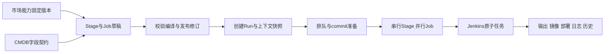

# 流水线编排组装与执行方案入口

当前完整推荐方案见 [总览](design/00-overview.md)。用户已授权先将全部需求深入细化并按推荐方案写全，再集中审阅修改；本文件保留编排主题的阅读导航，具体规则以design目录为准。当前仅有设计文档，未实现产品代码。

## 编排链路

## 分主题阅读

| 主题 | 当前推荐方案 |
|---|---|
| Job模板、参数、脚本、凭据、版本与市场 | [Job市场](design/03-job-catalog.md) |
| 流水线身份、复制、启停、归档与权限 | [流水线管理](design/04-pipeline-management.md) |
| 草稿、Stage/Job编辑、绑定、校验、修订与冲突 | [组装与编辑器](design/05-pipeline-editor.md) |
| Run准备、状态机、手动、配额、失败、取消、超时与恢复 | [执行规则](design/06-execution.md) |
| Controller、Runner认领、Agent、凭据、目录、缓存与容量 | [Jenkins接入](design/07-jenkins.md) |
| commit、配置、输入输出、镜像、节点、日志、部署与保留 | [数据与审计](design/08-data-and-audit.md) |
| 跨服务授权、依赖故障、部署、迁移与恢复 | [通用运行](design/09-operations.md) |
| 页面导航、编辑器、运行图与日志交互 | [用户交互](design/10-user-experience.md) |
| 表、字段、约束、事务、API与内部执行协议 | [数据模型与API](design/11-data-model-and-api.md) |
| 实施顺序、验收与76项需求追踪 | [实施与验收](design/12-delivery-and-acceptance.md) |

## 不变的业务语义

- Stage串行，同Stage Job并行。手动Job只等待自身，当前全部成功才进入下一Stage。
- 草稿可不完整保存；只运行不可变修订。Run固定配置快照，准备完成后固定commit。
- 平台负责编排，Jenkins负责原子执行；API与Worker从首期分进程，共用简单业务代码。
- executionId与canonical build关联逻辑任务，重复提交通过认领限制，不宣称外部副作用绝对只发生一次。
- 结果不明时核对，确认远端结束后才释放互斥资源；历史事实不随配置或重跑改写。
- 只运行当前协议；旧格式显式迁移，不保留兼容解释器。

## 当前契约示例

- [流水线定义](examples/pipeline.definition.v1.json)
- [完整可发布Definition Schema](schemas/pipeline.definition.v1.schema.json)
- [Job模板版本](examples/job-template-version.v1.json)
- [单Job执行规格](examples/job.execution-spec.v1.json)
- [CMDB交付上下文](examples/cmdb.delivery-context.v1.json)
- [Job结果封装](examples/job.result.v1.json)

Schema验证结构，跨Stage引用、模板契约、100Job总限额、空间权限、镜像来源和并发冲突还需服务端语义校验。示例不能替代完整业务验收。

## 推荐策略摘要

同应用环境共享一个活动Run槽，人工等待占槽；人工和应用槽排队默认24小时、Jenkins排队30分钟。并行首个失败停止新任务，已认领兄弟收敛。首期整体新Run，不提供单Job重试。部署使用可追溯digest；日志30天，结构化历史730天且引用可延长。所有取舍与影响集中见 [重点取舍](design/13-review-decisions.md)。

原长篇草案已归并入完整设计，避免两处维护不同默认值和执行规则。
